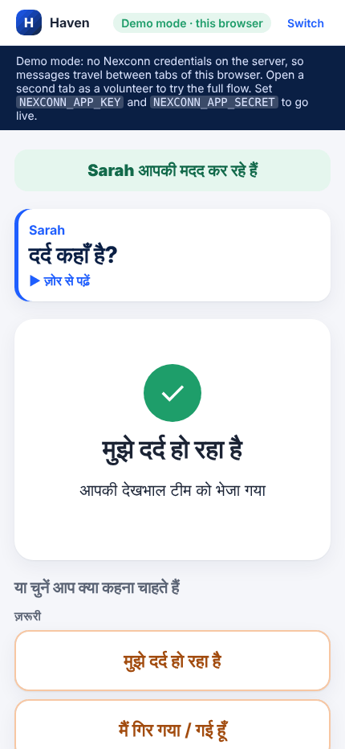

# Haven — powered by Awaaz

**Chat for people who can't be understood.**

Haven is an accessible, multilingual care-messaging network for seniors and people with neurological speech impairment (after a stroke, or with Parkinson's, ALS/MND, cerebral palsy or a brain injury). It runs on the **Nexconn Chat SDK** and was built for the Nexconn Build Challenge 2026 (Open Innovation track).

> Haven supports care. It does not diagnose and is not an emergency service.

<p align="center">
  
  &nbsp;
  
</p>

## The problem

Dysarthria weakens the muscles used for speech, so words come out slurred, slow or quiet while thinking stays clear. Family, nurses and volunteers can't understand the person, small keyboards are hard to use, and generic speech recognition is trained on typical voices. Needs go unmet and help arrives late.

## What Haven does

| Step | What happens | Where |
|---|---|---|
| **Speak or tap** | The member speaks in their own way, or taps a large phrase button. | `src/views/MemberView.tsx` |
| **Awaaz proposes** | Awaaz ranks the phrase bank and shows the **top 3** as big buttons, or **abstains** ("please try again") when unsure. | `src/awaaz/` |
| **Confirm** | Nothing is sent until the member taps the right phrase. | |
| **Deliver** | The phrase goes out over Nexconn as a `haven:say` message carrying a **phrase id**, so every reader sees it in **their own language** (English, हिन्दी, ਪੰਜਾਬੀ) with no machine translation. | `src/i18n/phrases.ts` |
| **Dispatch** | Urgent and medium phrases open a **case** in the volunteer Dispatch room (a Nexconn group channel). | `src/model/state.ts` |
| **Own it** | A volunteer **claims** the case, replies 1:1 (Nexconn direct channel) with quick replies that arrive in the member's language and are **read aloud**, then **resolves** it. | `src/views/ConsoleView.tsx` |
| **Never lost** | Unclaimed cases **escalate** after an SLA (high 2 min, medium 5 min). **Check-ins** that get "not okay" or no reply within 10 min open a case. | `src/model/useHaven.ts` |

## How it uses the Nexconn Chat SDK

| Nexconn capability | Haven usage |
|---|---|
| `NCEngine.initialize` / `connect` | Connect with a token issued by the Haven server |
| `NCEngine.registerCustomMessages` | `haven:say`, `haven:case`, `haven:checkin`, `haven:hello` |
| `GroupChannel.sendMessage` | Dispatch room: member requests, case lifecycle events, check-ins |
| `DirectChannel.sendMessage` | 1:1 replies from volunteer or family to the member |
| `BaseChannel.createMessagesQuery` / `createChannelsQuery` | Rebuild all cases from history after reconnecting |
| `MessageHandler.onMessageReceived` | Real-time updates |
| `DirectChannel.sendTypingStatus` + `ChannelHandler.onTypingStatusChanged` | "Sarah is responding…" |
| `ConnectionStatusHandler` | Live connection indicator |
| Push (default) | `haven:say` and `haven:checkin` keep push on so offline volunteers are alerted |
| Platform API `/v4/auth/access-token/issue`, `/v4/group-channel/create`, `/v4/group-channel/join` | Server-side token issue and Dispatch room membership (signed with App Secret, never sent to the browser) |

State is **event-sourced**: every case is a projection of the ordered message log, so any client that reconnects rebuilds exactly the same view from Nexconn history. See [docs/architecture.md](docs/architecture.md).

## Run it

Requires Node.js 18.17+.

```bash
npm install
cp .env.example .env      # add NEXCONN_APP_KEY and NEXCONN_APP_SECRET to go live
npm run dev               # http://localhost:5173 — web app + API in one process
```

- **With Nexconn credentials** (Console → Key Management): messages go through Nexconn. Open the app on two devices, one as *I need support*, one as *Volunteer*.
- **Without credentials**: Haven starts in **demo mode**, and messages travel between tabs of the same browser so the full flow can be tried locally. A banner makes this clear.

Production: `npm run build && npm start` (serves `dist/` and the API on `PORT`, default 8787).

Tests: `npm test` (signature, token issue, failover, session API, Awaaz ranking and abstention) and `npm run typecheck`.

## Project layout

```
server/            App server: signed Nexconn Platform API client, session API, production server
src/awaaz/         AwaazEngine interface + open reference engine (ranking, abstention, habit prior, speech)
src/transport/     Transport interface; NexconnTransport (production) and LocalTransport (demo only)
src/model/         Event-sourced state: cases, check-ins, escalation, conversation projection
src/views/         Onboarding, large-type member screen, volunteer/staff dispatch console
src/i18n/          Phrase bank (EN / HI / PA) and member UI strings
test/              Awaaz ranking tests
```

## About Awaaz

Awaaz was the flagship feature of **NeuroTrace**, our post-stroke recovery system (Top 5 nationally out of 39,843+ applications, Samsung Solve for Tomorrow 2026). The production Awaaz engine learns each person's own voice from consented recordings; its core algorithms are proprietary and **not included in this repository**.

This repository ships an open **reference engine** behind the same `AwaazEngine` interface: it takes hypotheses from the browser's speech recogniser, ranks them against the closed phrase bank, adds a small personal habit prior from the member's own confirmations, and abstains below a confidence threshold. It keeps the same product contract (top 3, confirm before send, abstain when unsure) but it is not speaker-adaptive and works best in browsers with speech recognition (Chrome, Edge). The phrase board always works without voice.

## Privacy and safety

- The App Secret stays on the server; the browser only receives an access token.
- Nothing is sent without the member's confirmation, and Awaaz abstains rather than guessing.
- The reference engine uses the browser's recogniser; the production Awaaz engine processes audio on the device.
- Haven is a communication and care-coordination tool, not a medical device.

## Status and limits

- Built and tested end-to-end in demo mode; the Nexconn path follows the official Web SDK and Platform API docs and needs an App Key and Secret to run live.
- The phrase bank is intentionally small; free text from carers is delivered as written.
- Escalation and check-in timers run on open volunteer and staff consoles.

## Team

Team **Incognito**, Thapar Institute of Engineering & Technology, Patiala.

## License

MIT for the Haven application code (see [LICENSE](LICENSE)). The proprietary Awaaz engine is not part of this repository.
