<p align="center">
  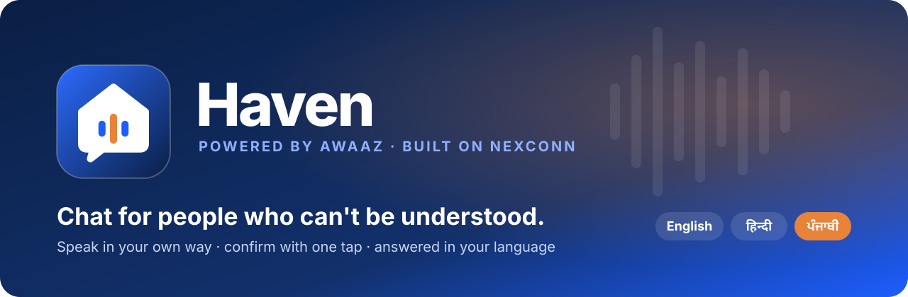
</p>

<p align="center">
  <a href="#-quick-start"></a>
  
  
  
  
  <a href="LICENSE"></a>
</p>

<p align="center">
  <b>Speak in your own way.</b> &nbsp;·&nbsp; <b>Confirm with one tap.</b> &nbsp;·&nbsp; <b>Someone answers, in your language.</b>
</p>

---

## Contents

1. [Haven in 30 seconds](#-haven-in-30-seconds)
2. [The problem](#-the-problem)
3. [What Haven does](#-what-haven-does)
4. [See it](#-see-it)
5. [How it works](#-how-it-works)
6. [Architecture](#-architecture)
7. [Inside Awaaz](#-inside-awaaz)
8. [Built on Nexconn](#-built-on-nexconn)
9. [Quick start](#-quick-start)
10. [Configuration](#-configuration)
11. [API reference](#-api-reference)
12. [Project structure](#-project-structure)
13. [Testing](#-testing)
14. [Privacy, safety and honest limits](#-privacy-safety-and-honest-limits)
15. [Roadmap](#-roadmap)
16. [Brand](#-brand)
17. [Team and license](#-team-and-license)

---

## ✦ Haven in 30 seconds

Some people know exactly what they want to say but **can't be understood**: after a stroke, with Parkinson's, ALS/MND, cerebral palsy, a brain injury, or simply as their voice weakens with age.

Haven gives them a way to ask for help that works:

| | |
|---|---|
| 🗣️ **They speak, or tap** | Large buttons, voice input and almost no typing. |
| ✅ **Awaaz shows its best guesses** | The top 3 phrases appear as big buttons. If it isn't sure, it asks again instead of guessing. |
| 🌐 **Everyone reads their own language** | A message sent in Hindi arrives in English for the volunteer, and the reply comes back in Hindi, read aloud. |
| 🙋 **Someone owns every request** | Urgent messages become cases a volunteer claims. Unclaimed cases escalate on a timer. |
| 💬 **Nobody falls silent** | Daily check-ins: a "not okay" or no reply alerts a volunteer. |

> Haven supports care. It does not diagnose and is not an emergency service.

---

## ✦ The problem

**Dysarthria** is a motor speech disorder: the muscles of the lips, tongue, larynx and breathing become weak, slow or uncoordinated. Cognition and language are often intact. The person knows the sentence; the *signal* breaks down.

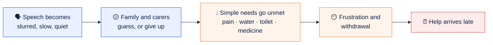

Every layer of today's technology assumes a typical speaker:

| Existing approach | Why it breaks | Failure mode |
|---|---|---|
| Voice typing / generic ASR | Trained on typical speech; acoustic mismatch on dysarthric speech | Domain shift |
| Indian-language coverage | No public dysarthric speech corpus for Hindi or Punjabi | Data scarcity |
| Keyboards and small touch targets | Tremor, weakness and low vision make typing slow or impossible | Motor and visual access |
| Symbol boards (AAC) | Helpful, but generic and not connected to anyone who can respond | No routing |
| Consumer chat apps | One language per thread; no triage, owner or escalation | No accountability |

---

## ✦ What Haven does

| Capability | Who it serves | Details |
|---|---|---|
| **Awaaz voice input** | Member | Speak, then see the top 3 likely phrases as large buttons. Abstains below a confidence threshold. |
| **Phrase board** | Member | 14 everyday phrases grouped as *Urgent*, *Needs* and *Other*. Always works, even without a microphone. |
| **Per-reader language** | Everyone | Messages carry a phrase id, so each reader sees them in English, हिन्दी or ਪੰਜਾਬੀ, with no translation service involved. |
| **Read aloud** | Member | Replies are spoken in the member's language with the browser's speech synthesis. |
| **Dispatch room** | Volunteers, staff | Urgent and medium requests open cases, sorted by urgency and age. |
| **Claim → reply → resolve** | Volunteers | One tap to own a case; quick replies arrive in the member's language. A timeline records who did what and when. |
| **SLA escalation** | Staff | Unclaimed after 2 min (high) or 5 min (medium) → escalated automatically. |
| **Check-ins** | Members, volunteers | "How are you today?" A "not okay", or no reply within 10 min, opens a case. |
| **Live KPIs** | Staff | Open cases, cases over SLA, median time to claim. |
| **Family view** | Family | Follow a relative and reply in your own language. |

---

## ✦ See it

<p align="center">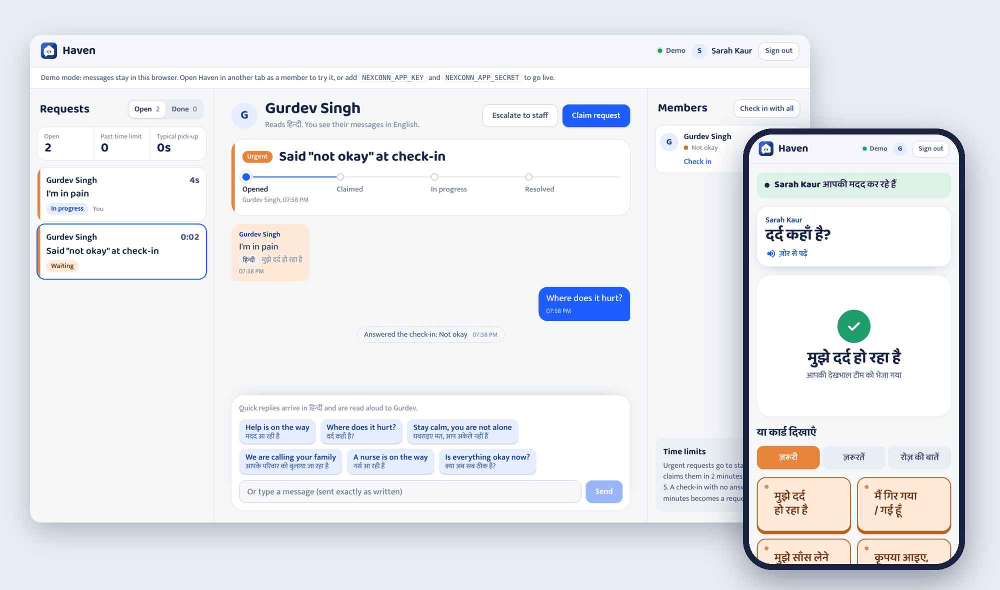</p>

**The member app** is built around tactile phrase cards, modelled on the laminated communication boards used in speech therapy. Each card has a thick printed edge and presses down when tapped. Colour carries meaning: saffron for urgent, blue for needs, green for everyday.

<p align="center">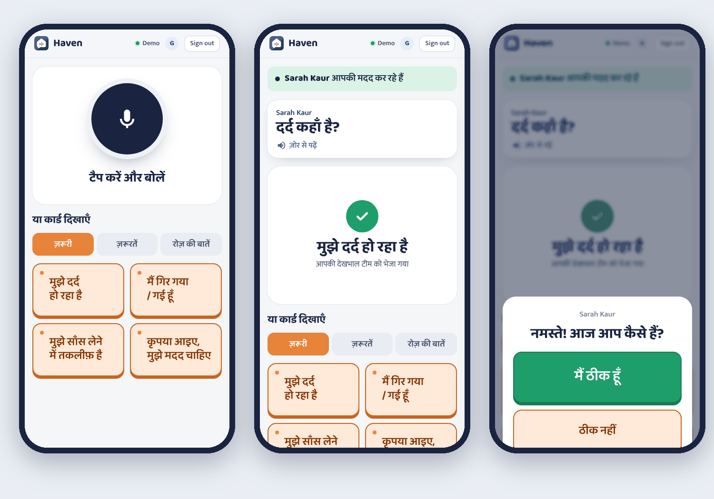</p>
<p align="center"><sub>Tap and speak or show a card &nbsp;·&nbsp; the volunteer's English reply arrives in Hindi and is read aloud &nbsp;·&nbsp; a check-in with two giant answers</sub></p>

**The dispatch console** shows every request with a live waiting timer, a progress stepper for each case, and quick replies that show both your language and the member's.

<p align="center">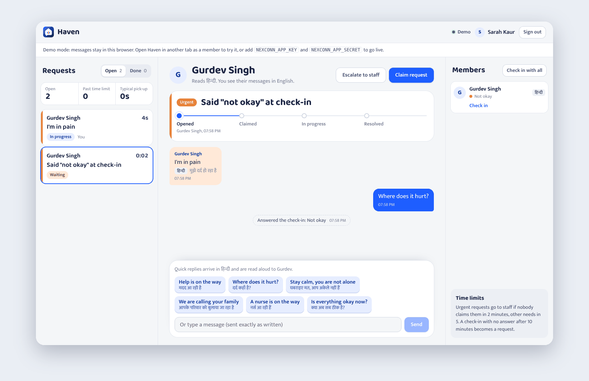</p>

<p align="center">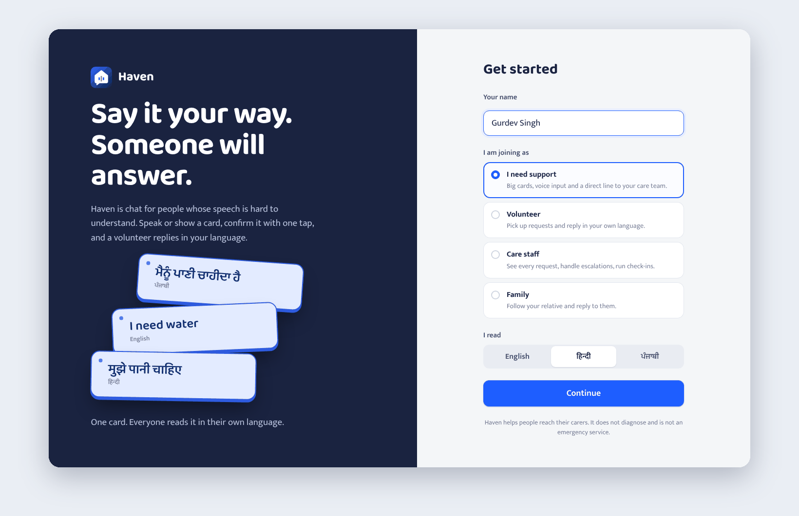</p>
<p align="center"><sub>Onboarding: one card, read in Punjabi, English and Hindi.</sub></p>

---

## ✦ How it works

### The journey of one request

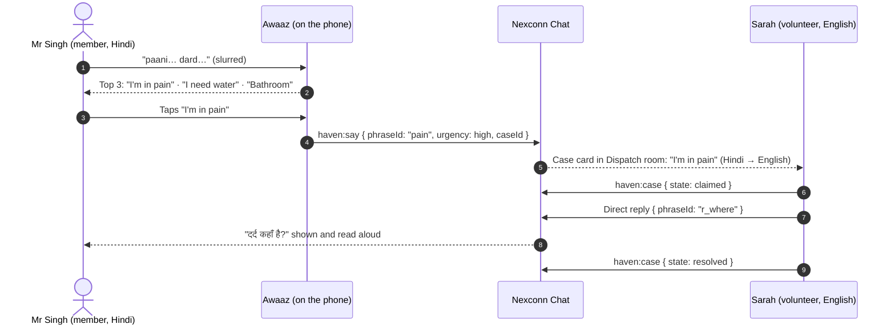

### Case lifecycle

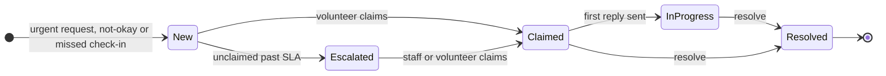

| Urgency | Example phrases | Opens a case? | Escalates if unclaimed after |
|---|---|---|---|
| 🔴 High | I'm in pain · I have fallen · I can't breathe properly · Please come | Yes | 2 min |
| 🔵 Medium | Water · Bathroom · Medicine · Call my family · Hungry | Yes (if none is open) | 5 min |
| ⚪ Low | I'm okay · Thank you · Yes · No · I feel cold | No | — |

### Check-ins

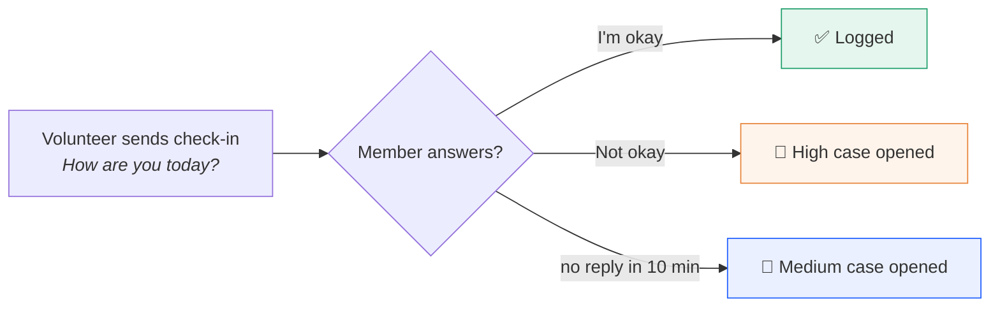

---

## ✦ Architecture

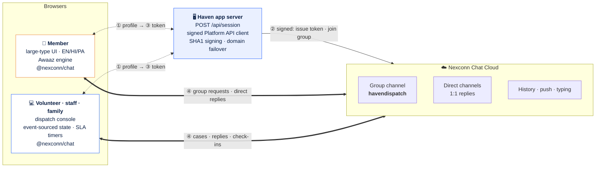

### Design principles

| Principle | In practice |
|---|---|
| **Speaker-dependent, not speaker-independent** | Model the one person in front of you, not a population of typical voices. |
| **Human in the loop** | Awaaz proposes; the member confirms. Nothing is sent on a guess. |
| **Abstain over hallucinate** | Below a threshold, ask again. A wrong message is worse than none. |
| **Closed vocabulary → exact translation** | Messages carry phrase ids, so rendering in each language is deterministic. |
| **Communication is a workflow** | Every request has an owner, a timer and a history. |
| **Event sourcing** | Every view is a fold over the message log, so any reconnecting client rebuilds the same state from Nexconn history. |
| **Secrets stay on the server** | The browser only ever receives a short-lived access token. |

### Message model

All application data travels as registered Nexconn custom messages.

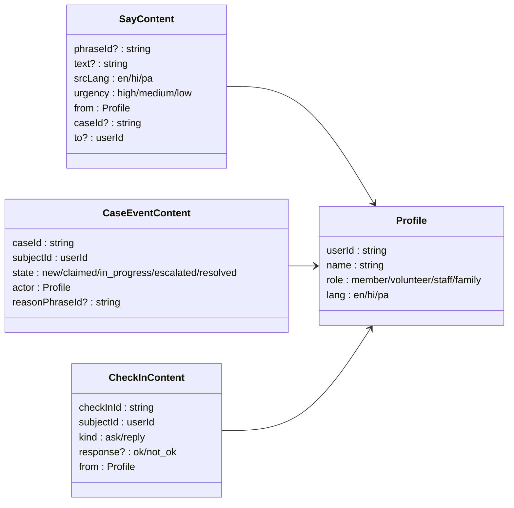

| Nexconn message type | Channel | Persisted | Counts as unread | Push |
|---|---|---|---|---|
| `haven:say` | group (member) · direct (carer) | ✓ | ✓ | ✓ |
| `haven:case` | group | ✓ | — | — |
| `haven:checkin` | group | ✓ | ✓ | ✓ |
| `haven:hello` | group | ✓ | — | — |

---

## ✦ Inside Awaaz

Awaaz was the flagship feature of **NeuroTrace**, our post-stroke recovery system (Top 5 nationally out of 39,843+ applications, Samsung Solve for Tomorrow 2026). It reframes the problem from *"transcribe any speech"* to *"recognise this person's everyday intents"*: closed-set intent recognition with a confirmation step.

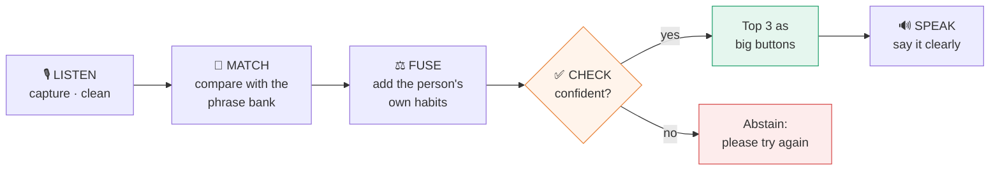

### Two engines, one contract

```ts
interface AwaazEngine {
  readonly available: boolean;
  listen(lang: 'en' | 'hi' | 'pa', signal?: AbortSignal): Promise<{ candidates: { phraseId: string; score: number }[]; abstained: boolean }>;
  confirm(phraseId: string): void; // personalises future ranking
}
```

| | Reference engine (in this repo) | Production Awaaz (NeuroTrace) |
|---|---|---|
| Input | Browser speech recogniser hypotheses (up to 5) | The member's own voice |
| Model | Ranks the closed phrase bank by text evidence | Speaker-dependent, learned from the member's consented recordings |
| Personalisation | Habit prior from the member's confirmations | Personal example bank that grows with every confirmation |
| Runs | In the browser | On the device |
| License | MIT, open | Proprietary, not included |

### How the reference engine scores a phrase

For each phrase *p* and recogniser hypotheses *h₁ … hₖ*:

```
text(p)   = max over hᵢ of  max( cue(hᵢ, p) , 1.4 · J₃(hᵢ, p) )      clipped to [0, 1]
J₃(h, p)  = | trigrams(h) ∩ trigrams(p) | / | trigrams(h) ∪ trigrams(p) |   over EN, HI and PA texts
cue(h, p) = 0.75 + 0.25 · J₃   if a cue word (romanised or native script) appears, else 0
habit(p)  = smoothed frequency of p in the member's confirmations, overall and by part of day
score(p)  = 0.8 · text(p) + 0.2 · habit(p)          (0 when there is no text evidence)

propose the top 3   if  max score ≥ τ = 0.35,   otherwise abstain
```

The habit prior only separates close candidates; it can never invent a phrase with no evidence. Example rankings from the test suite:

| What was heard | Top candidate | Result |
|---|---|---|
| `mujhe paani chahiye` (romanised Hindi) | I need water | proposed |
| `मुझे दर्द हो रहा है` (Devanagari) | I'm in pain | proposed |
| `ਮੈਨੂੰ ਸਾਹ ਨਹੀਂ ਆ ਰਿਹਾ` (Gurmukhi) | I can't breathe properly | proposed |
| `I fell down` | I have fallen | proposed |
| `blah blah weather` | — | **abstained** |

---

## ✦ Built on Nexconn

The integration follows the official Nexconn Web quickstart: **initialize once → register custom messages → add handlers → connect with a server-issued token → send and query.**

| Nexconn capability | Haven usage | File |
|---|---|---|
| `NCEngine.initialize({ appKey, areaCode })` | One-time SDK setup | `src/transport/nexconn.ts` |
| `NCEngine.registerCustomMessages` | `haven:say`, `haven:case`, `haven:checkin`, `haven:hello` | 〃 |
| `NCEngine.connect({ token })` | Token issued by the Haven server | 〃 |
| `GroupChannel.sendMessage` | Dispatch room: requests, case events, check-ins | 〃 |
| `DirectChannel.sendMessage` | 1:1 replies from volunteer or family | 〃 |
| `BaseChannel.createMessagesQuery` · `createChannelsQuery` | Rebuild cases from history on reconnect | 〃 |
| `MessageHandler.onMessageReceived` | Real-time updates | 〃 |
| `DirectChannel.sendTypingStatus` · `ChannelHandler.onTypingStatusChanged` | "Sarah is responding…" | 〃 |
| `ConnectionStatusHandler` | Live connection indicator | 〃 |
| Platform API `/v4/auth/access-token/issue` | Register user, issue token | `server/nexconn.js` |
| Platform API `/v4/group-channel/create` · `/join` | Create and join the Dispatch room | 〃 |

The SDK (~200 kB gzipped) is **lazy-loaded** only when the server is configured for Nexconn.

---

## ✦ Quick start

**Requirements:** Node.js 18.17+ and a Chromium-based browser for voice input (the phrase board works everywhere).

```bash
git clone https://github.com/prabindersinghh/haven.git
cd haven
npm install
npm run dev          # http://localhost:5173 — web app and API in one process
```

### Two ways to run

| Mode | When | What happens |
|---|---|---|
| **Live (Nexconn)** | `NEXCONN_APP_KEY` and `NEXCONN_APP_SECRET` are set | Messages travel through Nexconn. Open Haven on two devices, one as *I need support*, one as *Volunteer*. |
| **Demo** | No credentials | Messages travel between tabs of the same browser. A banner says so. Great for trying the flow in a minute. |

**Try the full flow in demo mode:**

1. Tab 1: choose **Volunteer**, language **English**.
2. Tab 2: choose **I need support**, language **हिन्दी**.
3. In tab 2, tap **मुझे दर्द हो रहा है** (or tap the mic and say it).
4. In tab 1, the case appears. **Claim** it and tap **Where does it hurt?**
5. Tab 2 shows **दर्द कहाँ है?** and reads it aloud.
6. In tab 1, tap **Check in**. Tab 2 gets the check-in; answer **ठीक नहीं** (not okay) and a new urgent case opens.

**Production:**

```bash
npm run build && npm start      # serves dist/ and the API on PORT (default 8787)
```

---

## ✦ Configuration

Copy `.env.example` to `.env`:

| Variable | Required | Default | Description |
|---|---|---|---|
| `NEXCONN_APP_KEY` | for live mode | — | App Key from Nexconn Console → Key Management |
| `NEXCONN_APP_SECRET` | for live mode | — | App Secret. **Server-side only**, never sent to the browser |
| `NEXCONN_REGION` | no | `sg` | Data center: `sg` (Singapore) · `na` (North America) · `sa` (Saudi Arabia) |
| `HAVEN_DISPATCH_CHANNEL_ID` | no | `havendispatch` | Group channel used as the Dispatch room |
| `PORT` | no | `8787` | Production server port |

---

## ✦ API reference

### `POST /api/session`

Registers the user with Nexconn, joins them to the Dispatch room and returns what the client needs to connect.

```http
POST /api/session
Content-Type: application/json

{ "name": "Gurdev Singh", "role": "member", "lang": "hi" }
```

```jsonc
// 200 OK (live)
{ "mode": "nexconn", "appKey": "…", "areaCode": 2, "token": "…", "userId": "membergurdevsingh3f1c09ab", "dispatchChannelId": "havendispatch" }
// 200 OK (demo)
{ "mode": "local", "userId": "membergurdevsingh3f1c09ab", "dispatchChannelId": "havendispatch" }
```

| Field | Rules |
|---|---|
| `name` | 1–40 characters |
| `role` | `member` · `volunteer` · `staff` · `family` |
| `lang` | `en` · `hi` · `pa` |

Errors: `400` invalid input · `413` body too large · `502` Nexconn platform error.

### `GET /api/health`

```json
{ "ok": true, "mode": "nexconn" }
```

### Request signing (server-side)

Every Platform API call carries `App-Key`, `Nonce` (≤ 18 chars, random), `Timestamp` (ms) and `Signature = hex(SHA1(AppSecret + Nonce + Timestamp))`. On a timeout or a 5xx response the client switches to the region's backup domain, for example `api.sg-light-api.com` → `api-b.sg-light-api.com`.

---

## ✦ Project structure

```
haven/
├── server/
│   ├── nexconn.js        Signed Nexconn Platform API client with domain failover
│   ├── api.js            /api/session and /api/health (shared by dev and prod)
│   ├── index.js          Production server: static dist/ + API
│   ├── env.js            Tiny .env loader
│   └── api.test.js       Signing, failover, session API tests
├── src/
│   ├── awaaz/
│   │   ├── engine.ts     AwaazEngine interface, reference engine, speech synthesis
│   │   └── match.ts      Ranking, habit prior, abstention (pure functions)
│   ├── transport/
│   │   ├── nexconn.ts    Production transport on @nexconn/chat
│   │   ├── local.ts      Demo transport (BroadcastChannel + localStorage)
│   │   └── types.ts      Transport interface
│   ├── model/
│   │   ├── state.ts      Event-sourced reducer: people, cases, check-ins, SLA
│   │   └── useHaven.ts   React hook: connect, history, actions, timers
│   ├── views/            Onboarding · MemberView · ConsoleView
│   ├── components/       Logo · MessageText
│   ├── i18n/             Phrase bank (EN/HI/PA) · member UI strings
│   └── styles.css
├── test/match.test.mjs   Awaaz ranking tests
└── docs/                 architecture.md · brand/ · screenshots/
```

---

## ✦ Testing

```bash
npm test          # 13 tests: signing, failover, session API, Awaaz ranking and abstention
npm run typecheck # strict TypeScript
npm run build     # typecheck + production bundle
```

| Suite | Covers |
|---|---|
| `server/api.test.js` | SHA1 signature format · nonce length · stable user ids · input validation · signed headers · primary → backup failover · demo vs live sessions · secret never returned |
| `test/match.test.mjs` | Romanised Hindi, Devanagari, Gurmukhi and English matching · abstention on unrelated speech · top-3 limit · habit prior raises confirmed phrases · empty input |

The full member ↔ volunteer flow (send, claim, reply in another language, check-in, "not okay" case) was also exercised end to end in two browser tabs.

---

## ✦ Privacy, safety and honest limits

**By design**

- 🔐 The App Secret never leaves the server; the browser gets an access token only.
- ✋ Nothing is sent without the member's confirmation, and Awaaz abstains rather than guessing.
- 🧾 Every case keeps a timeline of who claimed, replied, escalated and resolved it.
- 🩺 Haven is a communication and care-coordination tool, **not a medical device**.

**Honest limits**

- The open reference engine relies on the browser's speech recogniser, so it is **not speaker-adaptive**; the production Awaaz engine is.
- Awaaz works best on a personal vocabulary of everyday phrases, not open dictation. Free text from carers is delivered as written.
- Escalation and missed check-in timers run on open volunteer and staff consoles.
- Live mode needs a Nexconn App Key and Secret; demo mode is for local trials only.

---

## ✦ Roadmap

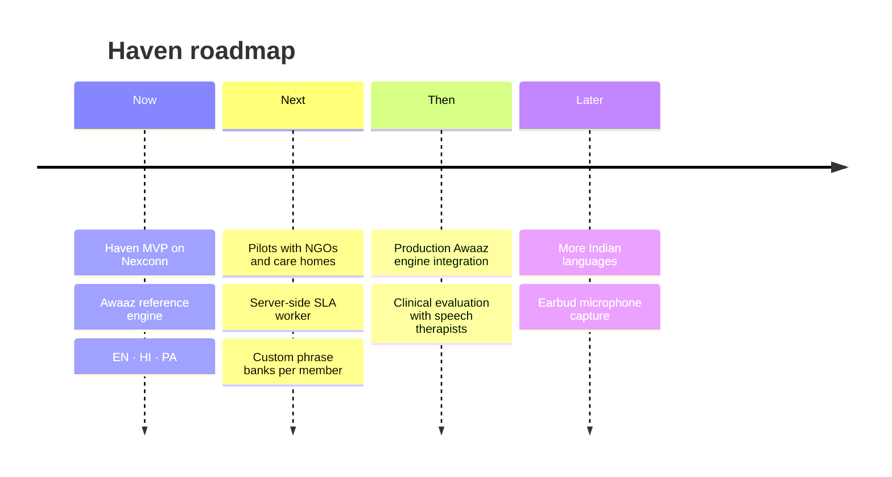

---

## ✦ Brand

<p>
  
  &nbsp;&nbsp;
  
  &nbsp;&nbsp;
  
</p>

**The mark:** a home that is also a speech bubble, holding a voice made clear. Shelter, conversation and Awaaz in one shape.

**Type:** [Baloo 2](https://fonts.google.com/specimen/Baloo+2) and [Baloo Paaji 2](https://fonts.google.com/specimen/Baloo+Paaji+2) for display, [Mukta](https://fonts.google.com/specimen/Mukta) and [Mukta Mahee](https://fonts.google.com/specimen/Mukta+Mahee) for text. Both families are by Ek Type and drawn for Devanagari and Gurmukhi, so Hindi and Punjabi are first-class rather than fallback fonts. Fonts are bundled, so Haven works offline.

**Tactile cards:** phrase cards borrow from physical AAC boards: a thick printed edge, a pressed state, and a colour code (saffron urgent, blue needs, green everyday).

| Navy | Blue | Orange | Green | Red |
|---|---|---|---|---|
| `#0A1F44` | `#1E5EFF` | `#E8833A` | `#1E9E6A` | `#D64545` |
| Brand, text | Actions, carers | Voice, urgent | Resolved, okay | Escalated |

Files: [`docs/brand/`](docs/brand) (`haven-mark.svg`, `haven-mark-mono.svg`, `haven-wordmark.svg`, `haven-banner.svg`).

---

## ✦ Team and license

Built by **Team Incognito**, Thapar Institute of Engineering & Technology, Patiala, for the Nexconn Build Challenge 2026 (Open Innovation).

Haven application code is released under the [MIT License](LICENSE). The proprietary Awaaz engine is not part of this repository.

<p align="center"><br/><sub>Clear minds deserve to be heard.</sub></p>
